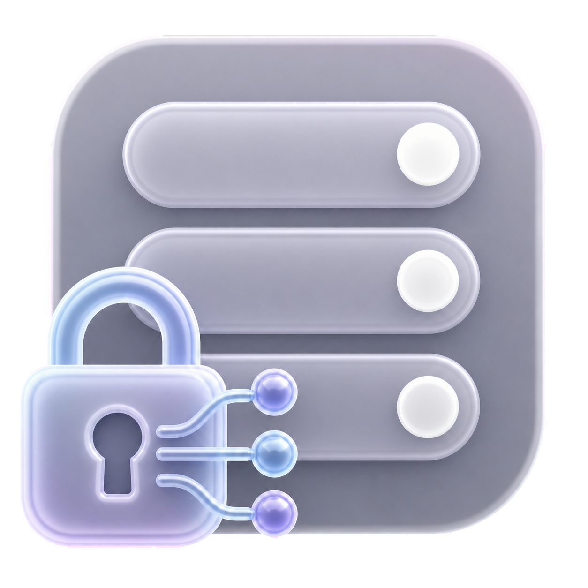

# SwiftNIO SSL

<!-- markdownlint-disable MD013 MD033 -->
<p>
  
  <a href="https://github.com/stephenlclarke/swift-nio-ssl/actions/workflows/main.yml?query=branch%3Amain"></a>
  <a href="https://github.com/stephenlclarke/swift-nio-ssl/actions/workflows/sonar.yml?query=branch%3Amain"></a>
  <a href="https://sonarcloud.io/summary/new_code?id=stephenlclarke_swift-nio-ssl"></a>
  <a href="https://sonarcloud.io/summary/new_code?id=stephenlclarke_swift-nio-ssl"></a>
  <a href="https://sonarcloud.io/summary/new_code?id=stephenlclarke_swift-nio-ssl"></a>
  <a href="https://sonarcloud.io/summary/new_code?id=stephenlclarke_swift-nio-ssl"></a>
  <a href="https://sonarcloud.io/summary/new_code?id=stephenlclarke_swift-nio-ssl"></a>
  <a href="https://sonarcloud.io/summary/new_code?id=stephenlclarke_swift-nio-ssl"></a>
  <a href="https://sonarcloud.io/summary/new_code?id=stephenlclarke_swift-nio-ssl"></a>
  <a href="https://sonarcloud.io/summary/new_code?id=stephenlclarke_swift-nio-ssl"></a>
  
</p>
<br clear="left" />
<br>
<!-- markdownlint-enable MD033 -->

SwiftNIO SSL is a Swift package that contains an implementation of TLS based on BoringSSL. This package allows users of [SwiftNIO](https://github.com/apple/swift-nio) to write protocol clients and servers that use TLS to secure data in flight.

The `stephenlclarke` fork carries the reviewed TLS corrections selected by the matched [`container-compose`](https://github.com/stephenlclarke/container-compose) development stack. Apple's [`swift-nio-ssl`](https://github.com/apple/swift-nio-ssl) remains the upstream source of truth; fork changes are kept narrow and prepared for upstream contribution. The current selected revision and compatibility status are recorded in the Container family's [STATUS.md](https://github.com/stephenlclarke/container-compose/blob/main/docs/project/STATUS.md).

On Darwin, the internal Security.framework certificate verifier rejects an untrusted peer through BoringSSL's default alert selection, matching the upstream TLS tests. This changes only the alert sent for a failed verification; it does not accept an untrusted certificate. Public custom verification callbacks retain their existing alert behavior.

The fork includes the current upstream BoringSSL update and closed-channel write fix. Internal verification returns an optional alert value alongside its result, keeping pointer writes at the BoringSSL callback boundary. This refactoring preserves the fork's existing Darwin and public-callback alert policy.

Linux integration checks use GNU `readelf` from `binutils` to require a non-executable `GNU_STACK` program header in both debug and release server binaries. Missing or executable stack metadata fails the check.

Hosted Linux benchmarks retain separate p90 allocation-count thresholds for each supported Swift toolchain, including Swift 6.4. A missing toolchain threshold fails the check rather than silently accepting a new baseline.

`make coverage` runs the package tests with instrumentation and binds the generated reports to the clean source revision and report checksum. `make sonar-scan` rejects stale or modified coverage, uses the exact checked-out commit as the project version, and supplies the current local branch explicitly. Local detached checkouts are rejected; supported GitHub Actions analyses keep automatic pull-request context.

The name is inspired primarily by the names of the library this package uses (BoringSSL), and not because we don't know the name of the protocol. We know the protocol is TLS!

To get started, check out the [API docs](https://swiftpackageindex.com/apple/swift-nio-ssl/main/documentation/niossl).

## Using SwiftNIO SSL

SwiftNIO SSL provides two `ChannelHandler`s to use to secure a data stream: the `NIOSSLClientHandler` and the `NIOSSLServerHandler`. Each of these can be added to a `Channel` to secure the communications on that channel.

Additionally, we provide a number of low-level primitives for configuring your TLS connections. These will be shown below.

To secure a server connection, you will need a X.509 certificate chain in a file (either PEM or DER, but PEM is far easier), and the associated private key for the leaf certificate. These objects can then be wrapped up in a `TLSConfiguration` object that is used to initialize the `ChannelHandler`.

For example:

```swift
let configuration = TLSConfiguration.makeServerConfiguration(
    certificateChain: try NIOSSLCertificate.fromPEMFile("cert.pem").map { .certificate($0) },
    privateKey: try .privateKey(.init(file: "key.pem", format: .pem))
)
let sslContext = try NIOSSLContext(configuration: configuration)

let server = ServerBootstrap(group: group)
    .childChannelInitializer { channel in
        // important: The handler must be initialized _inside_ the `childChannelInitializer`
        let handler = NIOSSLServerHandler(context: sslContext)

        [...]
        channel.pipeline.syncOperations.addHandler(handler)
        [...]
    }
```

For clients, it is a bit simpler as there is no need to have a certificate chain or private key (though clients *may* have these things). Setup for clients may be done like this:

```swift
let configuration = TLSConfiguration.makeClientConfiguration()
let sslContext = try NIOSSLContext(configuration: configuration)

let client = ClientBootstrap(group: group)
    .channelInitializer { channel in
        // important: The handler must be initialized _inside_ the `channelInitializer`
        let handler = try NIOSSLClientHandler(context: sslContext)

        [...]
        channel.pipeline.syncOperations.addHandler(handler)
        [...]
    }
```

The most recent versions of SwiftNIO SSL support Swift 5.7 and newer. The minimum Swift version supported by SwiftNIO SSL releases are detailed below:

SwiftNIO SSL        | Minimum Swift Version
--------------------|----------------------
`2.0.0 ..< 2.14.0`  | 5.0
`2.14.0 ..< 2.19.0` | 5.2
`2.19.0 ..< 2.23.0` | 5.4
`2.23.0 ..< 2.23.2` | 5.5.2
`2.23.2 ..< 2.26.0` | 5.6
`2.26.0 ..< 2.27.0` | 5.7
`2.27.0 ..< 2.29.3` | 5.8
`2.29.3 ..< 2.31.0` | 5.9
`2.31.0 ..< 2.35.0` | 5.10
`2.35.0 ..< 2.37.0` | 6.0
`2.37.0 ..<`        | 6.1
